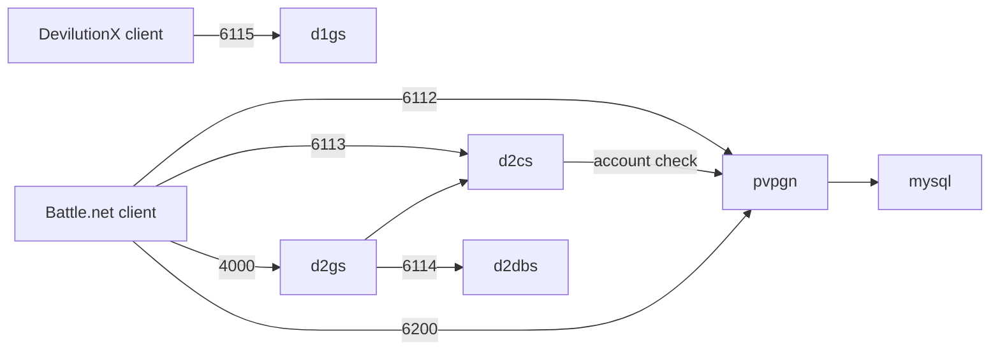

# d2srv

A local Battle.net for Diablo II, StarCraft, and Warcraft, plus a separate Diablo 1 server. Everything runs from Docker Compose. Configuration lives in one file, [`.env`](.env).

PvPGN 1.99.8 matches players and keeps accounts in MariaDB. StarCraft, Brood War, Warcraft II Battle.net Edition, and Warcraft III are hosted by the player who creates the game. Diablo II classic and Lord of Destruction use a dedicated game server (D2GS 1.13d) under Wine 11.22. Diablo 1 is a DevilutionX DevXH 1.0.2 server on its own port. The retail `Diablo.exe` does not see that game; join it with a DevilutionX client.

## Services

| Service | Image | Port | Role |
| --- | --- | --- | --- |
| pvpgn | `bnetd:latest` | TCP/UDP 6112, TCP 6200 | Battle.net. Port 6200 is the Warcraft III route. |
| d2cs | `bnetd:latest` | TCP 6113 | Diablo II realm. |
| d2dbs | `bnetd:latest` | TCP 6114 | Diablo II character database. |
| d2gs | `d2srv:latest` | TCP 4000 | Diablo II game server. |
| d1gs | `d1gs:latest` | TCP 6115 | Diablo 1, game name `d1gs`. |
| mysql | `mariadb:12.3` | none on the host | Official MariaDB 12.3 long-term release. Accounts only. |

The defaults are in `.env`. `render` runs once before the servers start. On an empty tree it copies the stock PvPGN files out of the bnetd image into `etc/` and `var/`, and it never overwrites a file that is already there. It then writes the generated files from [`templates/`](templates/). Those files are overwritten on every `up`:

- `etc/bnetd.conf`
- `etc/d2cs.conf`
- `etc/d2dbs.conf`
- `etc/address_translation.conf`
- `etc/realm.conf`
- `etc/i18n/news.txt`
- `conf/d2gs.reg`

`etc/i18n/news.txt` is the Battle.net news window. Its first lines are the build time and version of each image. The text under that list is `BNETD_NEWS` from `.env`; write `\n` where a new line should be.

Edit `.env`, then start the stack again. A hand edit of these generated files does not survive the next start. `render` runs as root so it can write those files for any host user. It does not change the other files in `etc/` and `conf/`.

## Architecture

The game containers share one bridge, `d2srv_net`. Compose gives each a fixed address from `.env`, and they call each other by hostname: `pvpgn`, `d2cs`, `d2dbs`, `d2gs`, `d1gs`, and `mysql`. `render` has no network. It writes the config files and exits. `pvpgn` waits until MariaDB is healthy. `d2gs` waits until `pvpgn`, `d2cs`, and `d2dbs` have started.

`pvpgn`, `d2cs`, and `d2dbs` are three programs from the `bnetd` image. They mount the same `etc/` and `var/`. Only `pvpgn` opens MariaDB. Accounts live in that database. Character files, ladders, and logs live in `var/`.



A Battle.net client logs in to `pvpgn` on port 6112. StarCraft, Brood War, and Warcraft II stay there. The player who creates the game hosts it, and the others connect to that player's computer. Warcraft III also uses port 6200 on the same `pvpgn` container. That port is the game route.

Diablo II goes on through the realm. `d2cs` keeps a connection to `pvpgn` and checks the account there. The client connects to `d2cs` on port 6113, then creates or selects a character. The character files are under `var/`. `d2gs` connects to `d2cs` and to `d2dbs` and signs in with `D2GS_PASSWORD`. When the player creates or joins a game, `d2cs` sends the client the address of `d2gs`. The client opens port 4000, and `d2gs` loads and saves that character through `d2dbs` on port 6114. That port stays on the Docker network. `d2cs` and `d2dbs` resolve the hostname `d2gs` to the fixed address of the game server.

Inside the bridge every service uses its private address. `address_translation.conf` is the address a client is given instead: `PUBLIC_IP` and the published port.

`d1gs` does not talk to `pvpgn`, MariaDB, or the Diablo II realm. A DevilutionX client opens its game directly on port 6115. `mysql` listens only on `d2srv_net`. The D2GS admin port 8888 stays inside the `d2gs` container.

## Ports for players

Open these on the host firewall. For players outside the LAN, forward the same ports from the router to this machine. The numbers below are the defaults in `.env`.

| Port | Protocol | Who connects |
| --- | --- | --- |
| 6112 | TCP and UDP | Every Battle.net client. TCP is login and chat. UDP is the connection test and peer-game announcements. |
| 6113 | TCP | Diablo II, to enter the realm. |
| 4000 | TCP | Diablo II, to play on the dedicated game server. |
| 6200 | TCP | Warcraft III and The Frozen Throne. |
| 6115 | TCP | Diablo 1 through a DevilutionX client, game name `d1gs`. |

StarCraft, Brood War, and Warcraft II use port 6112 only. The player who creates the game hosts it, so those players also need to reach each other.

Leave `6114` closed on the router. That is the Diablo II character database. Compose publishes it on the host, and players are sent to port `6112` instead. `d2cs` and D2GS reach `d2dbs` on the Docker network. MariaDB is not published. The D2GS admin port `8888` is not published.

## Client setup

StarCraft, Brood War, Warcraft II, and Warcraft III share one gateway list. The client always dials port `6112`. Close the game, including any Battle.net process, before changing the list. Diablo II keeps its own list; that procedure is in its section below.

On Windows, set `HKEY_CURRENT_USER\Software\Battle.net\Configuration` value `Battle.net gateways` to:

```text
1000
1
192.168.1.212
0
d2srv
```

Put `PUBLIC_IP` on the address line. `0` is the zone, and `d2srv` is the name shown in the gateway menu. In the game, open Battle.net and choose that gateway. The first visit uses Create New Account. The account is stored on this server and is the same account for every Battle.net game below.

The server does not ship patch MPQs, so the client must already be a version listed in `etc/versioncheck.json`.

### StarCraft and Brood War

Install classic StarCraft or Brood War **1.18**. Log in through the gateway above, then create or join a game from the channel. The player who creates the game hosts it, so the other players have to reach that computer.

### Warcraft II Battle.net Edition

Install **2.02b**. Log in through the same gateway, then create or join a game. The creator hosts it.

### Warcraft III

Install classic The Frozen Throne **1.28.5**. Reign of Chaos **1.28.2** also passes version check. Log in through the same gateway. Game traffic for this title also uses server port `6200`. The Battle.net app's Reforged client uses a different protocol and cannot log in here.

### Diablo II

Install Lord of Destruction **1.13c**. The game server is D2GS 1.13d, and that is the client it plays with.

The gateway list is `Diablo II Battle.net gateways` under `HKEY_CURRENT_USER\Software\Battle.net\Configuration`. Press Win+R, run `regedit`, and open that value. If it is missing, start the game once and click Battle.net so the client creates it.

The value starts with two service lines, such as `1009` and `01`. The second line is the number of servers. Each server is the next three lines: the address, a timezone offset, and the name shown in the menu. Add one to that count, then append:

```text
192.168.1.212
3
d2srv
```

Put `PUBLIC_IP` on the address line. `3` is the timezone offset. Close Registry, open Battle.net in the game, and choose `d2srv`.

Log in, choose the realm `REALM_NAME` (`D2CS`, described as `PvPGN Closed Realm`), and create a character. Creating and joining a game then connects to port `4000` on its own. A 1.14 client can pass the login check and still cannot enter a game on this server.

### Diablo 1

Install stock DevilutionX **1.5.5**, the version DevXH 1.0.2 is built from. Retail `Diablo.exe` has no way to reach this game.

DevilutionX reads the TCP port from its config, and the default is `6112`. Set it to `6115` before joining. On Windows the file is `%APPDATA%\diasurgical\devilution\diablo.ini`. Start the client once if the file is not there yet, then set:

```ini
[Network]
Port=6115
```

In the client choose Multiplayer, then TCP/IP, enter `PUBLIC_IP`, and join the game named `D1GS_NAME` (`d1gs`).

## Configure

Set `PUBLIC_IP` to the address players on the LAN use to reach this machine.

Set `DB_PASSWORD`, `DB_ROOT_PASSWORD`, and `D2GS_PASSWORD` before anyone outside the LAN can reach the host. A new database password applies when `./mysql` is created. An existing data directory keeps the password it was initialized with. The official image runs the server as user `mysql`, uid 999, and takes ownership of `./mysql` on startup.

Leave `D2DBS_TRANSLATE_PORT` at `6112`. That value is the address-translation entry for d2dbs, not the port of the d2dbs process.

## Run

```sh
docker compose up -d
```

The first run builds `bnetd`, `d1gs`, and `d2srv`, and pulls the official MariaDB image. That also pulls the Ubuntu and Alpine bases, the PvPGN and Wine sources, and the Diablo archives. The D2GS image compiles Wine and downloads the Diablo II MPQs and DLLs. The Diablo 1 image downloads `DIABDAT.MPQ`. Those game archives are not in this source tree, and the D2GS build takes a long time. A later run uses the images already built.

The same command creates `etc/`, `var/`, and `./mysql` when they are missing. Empty `etc/` and `var/` receive the stock PvPGN files. Files already on disk stay as they are. An empty `./mysql` receives a new database and the `pvpgn` account from `.env`. A directory that already contains MariaDB system tables keeps its accounts and passwords. If those tables come from an older MariaDB, the first start upgrades them in place.

StarCraft, Brood War, and Warcraft II patch MPQs are not in the PvPGN image and are not downloaded. A client that already passes version check does not need them.

Client gateway, version, realm, and Diablo 1 steps are in [Client setup](#client-setup).

Character files, ladders, and Battle.net autoupdate MPQs stay on the host under `var/`. The database stays in `./mysql`. Do not delete `./mysql` to reset a password.

## LAN games

StarCraft and Warcraft games are peer-hosted. Behind Docker Desktop, another computer on the LAN can see the game host as `192.168.65.1`, and the join then fails. Diablo II does not have this problem: the dedicated server owns the game.

## License

Apache License 2.0. See [LICENSE](LICENSE).

To report a vulnerability, see [SECURITY.md](SECURITY.md).
